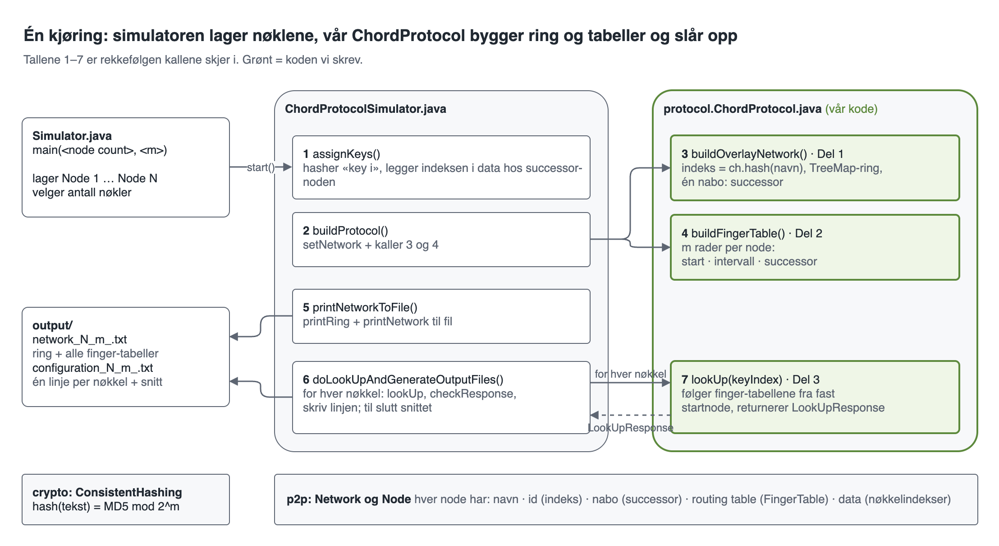

# IN5020 Assignment 3: Chord Protocol (Group 1)

A Chord peer-to-peer ring on top of the in-house simulator. The group implemented the overlay network, the finger tables and the look-up algorithm, and ran the three required configurations.

Requires Java 11 or newer.

## Run (ready-to-deploy jar)

    java -jar ChordSimulator.jar <node count> <m>

The three required configurations:

    java -jar ChordSimulator.jar 10 10

    java -jar ChordSimulator.jar 100 20

    java -jar ChordSimulator.jar 1000 20

All results are written to the output/ folder (created in the directory you run from). Nothing is printed to the console.

| File | Content |
| --- | --- |
| `output/configuration_<nodes>_<m>_.txt` | One line per key, then the average hop count |
| `output/network_<nodes>_<m>_.txt` | The ring, and every node with index, neighbor, finger table and stored keys |

Each lookup line has the form (as in the assignment):

    key 1:932 Node 9:1006 hop count: 3, route: Node 4 Node 6 Node 9

The last line of each configuration file is average hop count = <value>. The results in output/ are the ones from the three runs above (averages: 2.8 for 10/10, 3.95 for 100/20, 5.891666666666667 for 1000/20). The runs are deterministic, so they give the same files every time.

## Build from source

javac --release 11 -d bin $(find src -name "*.java")

java -cp bin Simulator 10 10

**To rebuild the jar (Main-Class is Simulator):**

printf 'Main-Class: Simulator\n' > manifest.txt

jar cfm ChordSimulator.jar manifest.txt -C bin .

## System overview

The diagram (labels in Norwegian) shows one run. The numbers 1 to 7 are the order of the calls, and the green boxes are the code we wrote.

- **Simulator.java** reads the node count and *m*, creates Node 1 … Node N, picks the number of keys and starts ChordProtocolSimulator.
- **1 assignKeys()** hashes every "key i" and stores its index at the successor node.
- **2 buildProtocol()** gives our protocol the network and calls **3 buildOverlayNetwork()** (part 1: index = ch.hash(name), TreeMap ring, one neighbor = successor) and **4 buildFingerTable()** (part 2: *m* rows per node with start, interval and successor).
- **5 printNetworkToFile()** writes the ring and all finger tables to `output/network_N_m_.txt`.
- **6 doLookUpAndGenerateOutputFiles()** calls **7 lookUp(keyIndex)** (part 3) for every key, which follows the finger tables from a fixed start node and returns a LookUpResponse. The response is checked, one line is written per key to `output/configuration_N_m_.txt`, and the average hop count is written last.
- Underneath, **crypto.ConsistentHashing** gives hash(text) = MD5 mod 2^m, and **p2p.Network/Node** holds each node's name, id (index), neighbor (successor), routing table (FingerTable) and data (key indexes).

The draw.io sources for this and the other explanation diagrams are in docs/diagrams/.

## How the three parts are implemented (src/protocol/ChordProtocol.java)

1. **Overlay network, buildOverlayNetwork()**: each node gets its index from ch.hash(<node name>). The nodes are placed in a sorted map (TreeMap) that represents the ring, a hash collision stops the run with an error, and every node gets its successor (the next index, wrapping around to the lowest) as neighbor.
2. **Finger table, buildFingerTable()**: row i (1..m) has start = (n + 2^(i-1)) mod 2^m, interval = (start, next start - 1) and as successor the first node at or after start on the ring. The last row ends at n, so the m intervals cover the whole ring exactly once. The interval check handles intervals that wrap around 0, e.g. (7,3).
3. **Look up, lookUp(keyIndex)**: always starts at the node with the lowest index. Each node that is visited is added to the route (this is the hop count). If the node stores the key, it is returned. Otherwise the node's finger table row whose interval contains the key index is followed. A loop guard stops with an error if a lookup ever gets stuck.

ChordProtocolSimulator looks up every key, checks that the node found really stores the key (no wrong lookups in any of the three runs), and writes the output files.

## Work distribution

- **Håkon Gulliksrud (haakgull@uio.no)**: first implementation of the three parts in ChordProtocol.java: buildOverlayNetwork(), buildFingerTable() and lookUp(), with comments.
- **Philip Elias Fleischer (philipef@uio.no)**: repository setup and .gitignore. Corrected the finger table (intervals) and lookUp() so they follow the assignment text exactly, so that all lookups in the three configurations are correct.
- **Anwar Ahmed Hersi (anwarahe@uio.no)**: output and delivery. Output format of the lookup lines, all printing written to files (the lookup files and the network dump), the three runs, the average hop count line, the jar file and this README.
